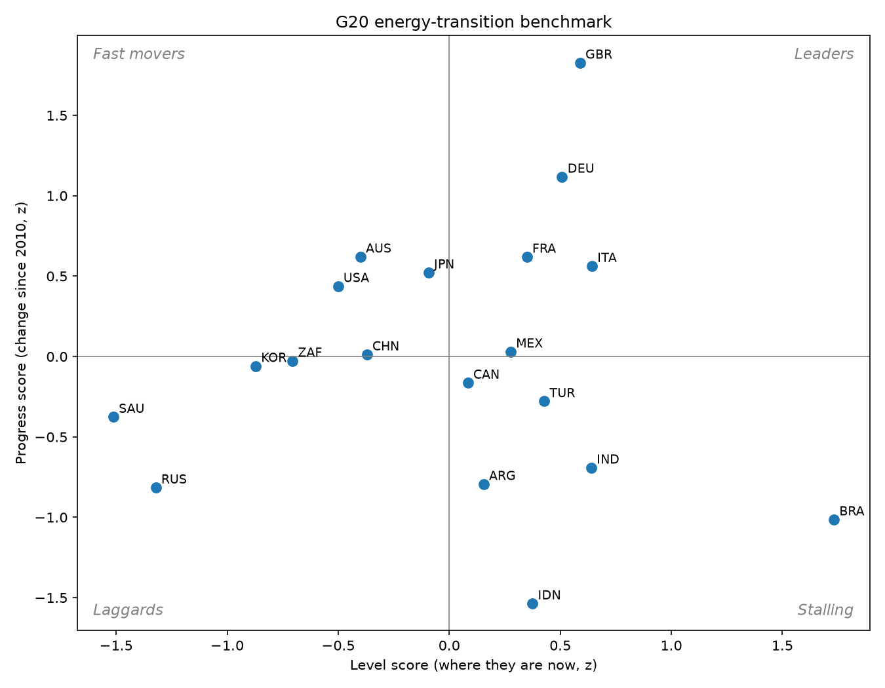
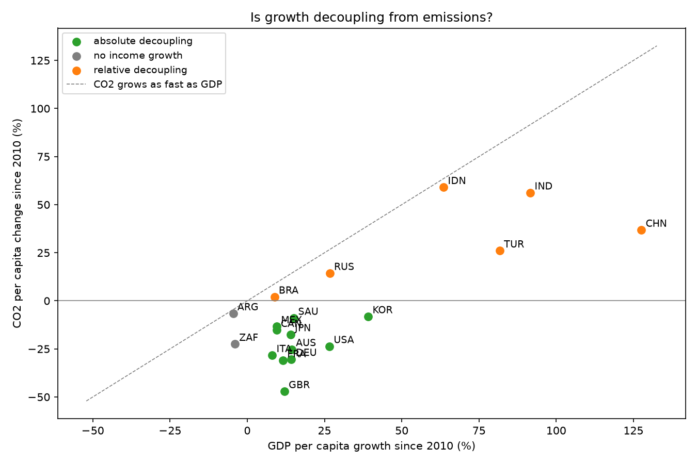
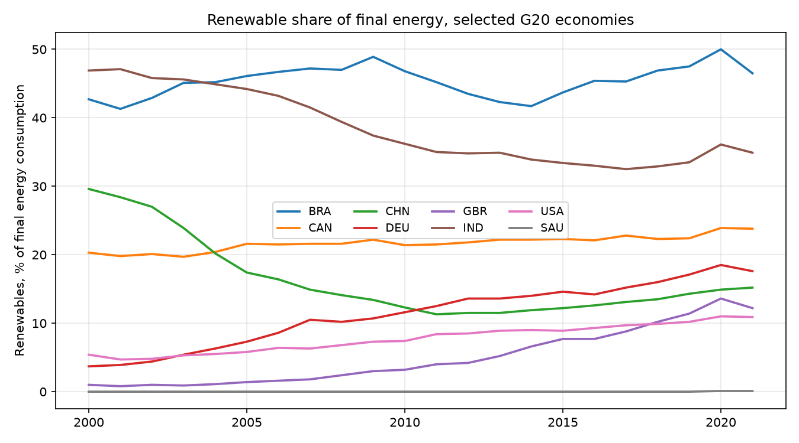

# G20 Energy-Transition Benchmark

A cross-country benchmarking study of the energy transition in G20 economies. It scores each country on **where it stands today** and **how fast it has moved since 2010**, tests whether economic growth is decoupling from CO₂ emissions, and models what explains differences in emissions per person.

> **Data:** public data from the [World Bank World Development Indicators API](https://datahelpdesk.worldbank.org/knowledgebase/articles/889392). `src/fetch_wdi.py` downloads it, and a cached copy is in `data/wdi_g20.csv`. No API key is needed.



## Indicators

| Indicator | WDI code | Latest year | Better when |
| --- | --- | --- | --- |
| Renewable share of final energy consumption | `EG.FEC.RNEW.ZS` | 2021 | higher |
| Renewable share of electricity output | `EG.ELC.RNEW.ZS` | 2021 | higher |
| Energy intensity (MJ per $ of PPP GDP) | `EG.EGY.PRIM.PP.KD` | 2022 | lower |
| CO₂ per capita, excluding land use | `EN.GHG.CO2.PC.CE.AR5` | 2024 | lower |
| GDP per capita (PPP, constant 2021 $) | `NY.GDP.PCAP.PP.KD` | 2024 | used for decoupling and controls |

**Data-quality catch:** the WDI fossil-fuel share series (`EG.USE.COMM.FO.ZS`) stops in 2015, and every later year is filled with `0.0` rather than left missing. Left in, it would make every country look fossil-free and break the regression (the design matrix became rank-deficient). It is excluded on purpose.

## Method

- **Level score:** the average of direction-adjusted z-scores of each country's latest value on the four transition indicators.
- **Progress score:** the same, applied to change since 2010. Shares use percentage-point change. Intensity and CO₂ use percent change.
- **Decoupling:** GDP per capita growth vs. CO₂ per capita change, 2010–2024. Countries are classed as *absolute* (CO₂ falls while GDP grows), *relative* (CO₂ grows more slowly than GDP), *coupled* (CO₂ grows at least as fast as GDP) or *no income growth*.
- **Emissions model:** a cross-section OLS with HC1 standard errors of `log(CO₂ per capita)` on `log(GDP per capita)`, renewable share and `log(energy intensity)`.

## Findings

- **The UK and Germany lead on progress.** Since 2010 the UK has cut CO₂ per person by 47% while growing GDP per person by 12%, the strongest absolute decoupling in the G20. Eleven of the 19 economies show absolute decoupling.
- **High level scores can hide weak progress.** Brazil tops the level score because of hydropower and bioenergy, and India and Indonesia also score well on renewables, but all three lose ground on progress. Part of their renewable share is traditional biomass, which falls as households modernize. A level-only ranking would miss that.
- **Fast-growing emerging economies are only relatively decoupled.** China, India, Indonesia and Türkiye cut emissions per unit of growth, but total CO₂ per person still rose 26–59%.
- **What explains emissions per person** (n = 19, R² = 0.91): a 1% higher income goes with about 0.66% higher CO₂ per person, and a 1% higher energy intensity with about 0.95% higher. Each additional percentage point of renewable share goes with about 1.6% lower CO₂ per person. All three are significant at 1%. With 19 countries in one cross-section, these are descriptive associations, not causal effects.





## Caveats

Indicators have different latest years (2021–2024), so "change since 2010" covers slightly different windows. The EU and African Union are G20 members but are left out because they are blocs, not countries.

## Run it

```bash
pip install -r requirements.txt
python src/fetch_wdi.py     # refresh data/wdi_g20.csv from the World Bank API
python src/benchmark.py     # scorecard, decoupling table, regression, figures
pytest -q
```

## Stack

Python · REST API ingestion (requests) · pandas · statsmodels · Matplotlib · pytest
